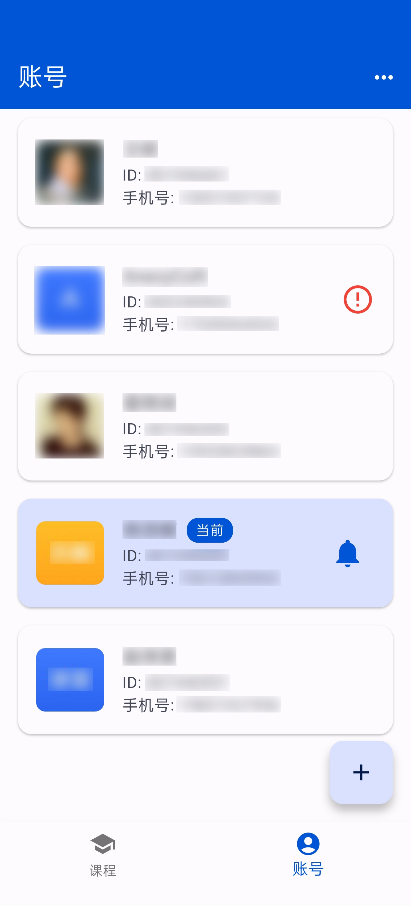
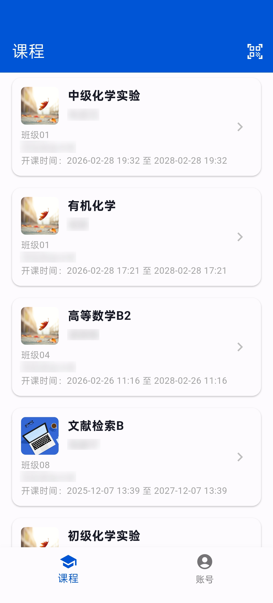
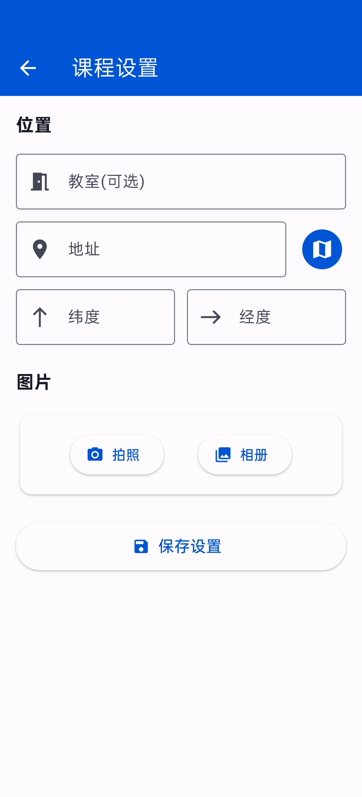
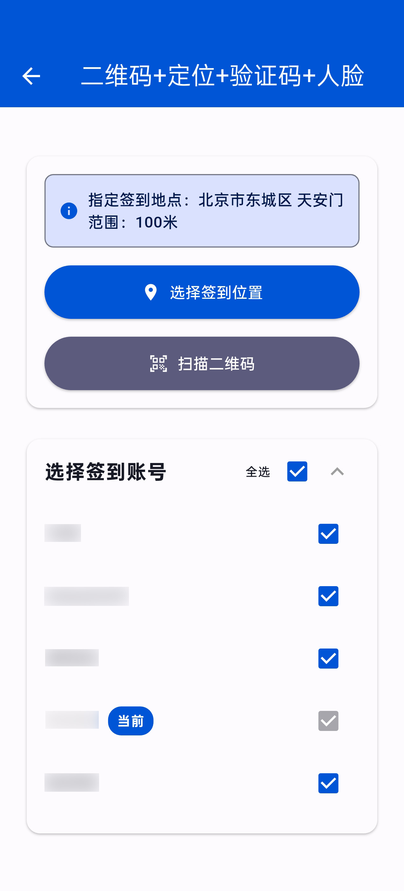
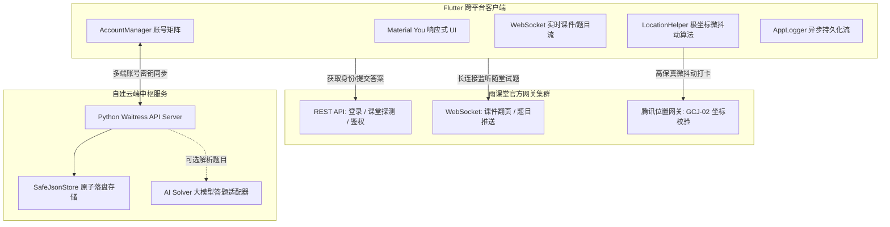

# 雨课堂助手 (Course Helper - Rain Classroom Edition)

<p align="center">
  
</p>

<p align="center">
  <strong>专为高校学子打造的现代化雨课堂全自动化管理、课件实时流同步、随堂练习与高保真位置打卡助手</strong>
</p>

<p align="center">
  
  
  
  
  
</p>

---

## 界面预览

| 账号管理 | 课堂列表 | 课程设置 | 签到与打卡 |
| :---: | :---: | :---: | :---: |
|  |  |  |  |

---

## 项目渊源与致谢 (Special Thanks)

本项目基于优秀开源项目 [AneryCoft/course_helper](https://github.com/AneryCoft/course_helper) 进行二次开发与架构演进，在此向原作者 **AneryCoft** 表达由衷的谢意！

### 我们的重构与深度自研创新
原项目是一个同时兼容学习通与雨课堂的双平台管理工具。本项目在严格遵循 **GNU General Public License v3.0 (GPL v3.0)** 协议的基础上，**将雨课堂框架彻底独立解耦**，并针对雨课堂平台的实际痛点进行了全方位的深度优化与全新功能自研：

1. **纯净雨课堂内核剥离**：彻底剔除无关依赖与多余逻辑，专研雨课堂全部服务器节点（通用版、荷塘、长江、黄河以及 Pro 专业版），大幅轻量化包体积与启动耗时。
2. **自研腾讯 LBS 极坐标微抖动位置打卡**：
   - 逆向分析雨课堂教师地理围栏打卡协议；
   - 引入 **Haversine 球面大圆距离公式** 进行精准距离验证；
   - 研发 **安全步长约束（3m~15m）极坐标微抖动算法**，生成符合自然人体随机分布的 GCJ-02 火星坐标，杜绝单点聚合作弊判定。
3. **全新自研云端多租户同步系统**：
   - 配套全新自研的 Python 生产级后端（`server/api_server.py`）；
   - 支持基于 API Key / Group Key 的租户隔离，多台移动设备之间实现一键静默加密备份与拉取账号凭证。
4. **全类型随堂答题与课件同步流重构**：
   - 强化 WebSocket 全双工长连接通道，实现 PPT 课件与随堂测验实时推流；
   - 支持单选题、多选题、投票题、填空题（多空位智能自适应排版）、主观题（多图拍照与文字混合上传）；
   - 内置答题保护与延时防封提交机制，并解耦了可插拔的 AI 答题引擎抽象层。
5. **系统级稳定性与无感保活体系**：
   - 引入非阻塞单消费者异步日志管道（`AppLogger`），防止高频多账号并发产生 I/O 阻塞；
   - 集成前台系统服务保活（`flutter_foreground_task`），防止后台切屏断联。

---

## 系统架构拓扑 (Architecture)



---

## 📱 App 核心使用方法 (User Manual)

为确保使用过程流畅，请务必熟悉以下工作流程与操作要点：

### 1. 配置服务器、登录与选择节点
- **配置服务器**：在源码 `lib/services/cloud_sync_service.dart` 中指定您的自建同步服务器 IP，或通过云端分发源动态获取；
- **登录账号**：在【账号管理】页面中，支持微信扫码登录或输入手机号验证码登录；如有配置同步密钥，点击右上角菜单即可一键拉取云端备份的所有账号；
- **选择雨课堂服务器类型**：点击右上角弹出菜单，根据所在学校的雨课堂实际节点切换服务器：
  - **雨课堂 (yuketang.cn)**：全国高校通用主流版；
  - **荷塘雨课堂 (ykt.io)**：清华大学等指定节点；
  - **长江雨课堂 (changjiang.yuketang.cn)**：长江流域高校指定节点；
  - **黄河雨课堂 (huanghe.yuketang.cn)**：黄河流域高校指定节点；
  - **雨课堂 Pro (pro.yuketang.cn)**：部分部署专业版的高校。

### 2. 正在上课课程显示机制
- **只显示上课中的课程**：为了保持界面纯净与专注，课程列表页**仅会展示当前教师正在开启上课中的课程**（非上课时间列表为空属正常现象）；
- **刷新技巧**：如果任课教师已在课堂开启了雨课堂但手机界面暂未刷新出卡片，**只需将 App 从手机后台任务列表中彻底划掉清除，重新打开应用即可秒级刷新显现**。

### 3. 签到全流程操作指南
- **普通签到与位置签到**：无需扫码！发现上课卡片出现后，**直接点击课程卡片**，系统将自动入课并完成身份鉴权与高保真极坐标微抖动位置打卡！
- **二维码签到**：若教师开启了限时动态二维码签到，**必须先点击右上角的【扫码】图标扫描教室大屏幕上的二维码**，提示扫码成功后，**再点进该课程卡片**完成最终的进班签到。

### 4. 随堂答题核心技巧
- **未下课前皆可答题（无视倒计时限制）**：突破官方客户端的限时倒计时约束，**只要教师未在黑板端点击“下课”，在整节课结束前的任何时间段内均可随时补答或修改提交**；
- **一键批量答题**：支持一览课件全部未作答试题，支持快速勾选并一键批量提交答案。

### 5. 💡 关于 AI 答题功能的特别说明
> [!IMPORTANT]
> - **重要提示**：目前本开源项目的 **App 移动客户端中暂未集成 AI 答题的前端交互模块**；
> - 配套服务端（`server/api_server.py` 与 `ai_solver.py`）已经完整实现并开放了对接大语言模型（如 DeepSeek、OpenAI、通义千问等）的 `/api/ai/solve` 题型解析接口；
> - **如需要使用 AI 自动解题功能，请开发者根据服务端接口文档自行在客户端二次开发对应 UI 按钮与调用逻辑**。

---

## 核心技术亮点解析

### 1. 👥 多账号矩阵与云端同步
- 支持多用户秒级无感切换，自动独立管理各账号专属 Session 与 Cookie 容器；
- 支持为各账号配置专属拟真设备指纹（Device Profile），隔离设备环境检测；
- 支持自建云端同步密钥，更换手机或跨多台平板时一键云端拉取，告别重复扫码登录。

### 2. 📍 高保真极坐标微抖动位置打卡
- 自动解析教师设定的考勤中心坐标（经度、纬度）与有效打卡半径；
- **算法核心逻辑**：
  $$\text{safeMax} = \min(\max(3.0, R \times 0.5), 15.0)$$
  在 $[3\text{m}, \text{safeMax}]$ 距离区间与 $[0, 2\pi]$ 方位角之间生成伪随机极坐标位移，严格保证位移处于安全合法围栏内，同时打破同一寝室/多人同时代签的经纬度完全重合特征。

### 3. 📝 智能随堂测试与课件同步
- 课堂进行中实时捕获教师投影翻页，支持高清课件全流程原图浏览与保存相册；
- 支持单选题、多选题、投票、填空题与主观问答题；
- 填空题动态分块独立编辑，主观题支持相册多选/相机拍摄即时上传附件；
- 智能答题保护：在用户输入未完成前锁定课件自动翻页，避免答题内容意外丢失。

---

## 快速开始 (Quick Start)

> [!NOTE]
> **关于安装包的说明**：由于本客户端需连接使用者自主配置的服务端 IP 与专用同步密钥，因此**本项目不提供预编译好的通用 APK 安装包**。请使用者按照以下步骤自行配置服务器地址并本地编译打包。

---

### 第一步：自建部署云端同步服务端 (Python)

如果您需要跨多台设备同步学生账号凭证，建议在个人 VPS 或局域网电脑中部署服务端：

#### 1. 环境准备与依赖安装
```bash
cd server
pip install -r requirements.txt
```

#### 2. 配置环境参数
复制配置模板文件：
```bash
cp .env.example .env
```
使用文本编辑器修改 `.env` 文件（或通过环境变量指定）：
```env
# 管理员全局操作口令（务必修改为强密码）
YKT_ADMIN_KEY=your_secure_admin_key_here

# 服务监听地址与端口
YKT_BIND_HOST=0.0.0.0
YKT_PORT=5000

# (可选) 启用 AI 答题（以 DeepSeek 为例）
YKT_AI_API_KEY=sk-your-deepseek-key
YKT_AI_BASE_URL=https://api.deepseek.com/v1
YKT_AI_MODEL=deepseek-chat
```

#### 3. 运行服务端
```bash
python api_server.py
```
若希望在 Linux 服务器长期后台运行，建议使用 Systemd 守护（详见 [server/README.md](server/README.md)）。

---

### 第二步：从源码构建客户端 (Flutter)

#### 1. 前置依赖准备
- 安装 [Flutter SDK](https://flutter.dev/docs/get-started/install) (`>= 3.41.0`)
- 安装 Android SDK 与 Java 17
- 配置好 Flutter 环境变量：`flutter doctor` 确保各组件正常

#### 2. 克隆项目与配置服务器地址
```bash
git clone https://github.com/your-username/course_helper.git
cd course_helper
```
打开 `lib/services/cloud_sync_service.dart`，将 `defaultServerUrl` 修改为您刚才部署的服务端地址：
```dart
static const String defaultServerUrl = 'http://<您的服务器IP>:5000';
```

#### 3. 拉取依赖并编译打包
```bash
# 获取 Dart 依赖包
flutter pub get

# 编译分架构 release APK
flutter build apk --release --split-per-abi
```
编译产物位于 `build/app/outputs/flutter-apk/` 目录下，选择匹配手机架构的安装包（推荐 `arm64-v8a`）安装至手机即可。

---

## 动态分发服务器配置 (可选高级特性)

为了防止更换 VPS 服务器或公网 IP 变更后需要频繁重新打包 App，客户端支持动态拉取云端 IP。

您只需在任何公开的静态页面、GitHub/Gitee 仓库或 CDN 上托管一个 `server_config.json` 文件：
```json
{
  "server_url": "http://your-actual-server-ip:5000"
}
```
并在客户端 `lib/services/cloud_sync_service.dart` 中的 `remoteConfigUrls` 列表中填入该链接，App 在启动时将自动静默探测并更新为最新的服务器地址！

---

## 项目结构导航

```text
course_helper/
├── android/            # Android 原生配置与 Gradle 构建脚本
├── ios/                # iOS 原生工程与权限声明 (保留真实百度地图 AK 支持)
├── images/             # 应用图标与各功能模块演示截图
├── lib/                # Flutter 客户端核心源码
│   ├── api/            # 雨课堂 REST/WebSocket 协议封装与通信拦截器
│   ├── models/         # 用户、课程、试题、位置打卡数据实体模型
│   ├── pages/          # 视图层 (课程列表/课件播放/登录/账号管理/位置打卡)
│   ├── services/       # 云端同步驱动 (CloudSyncService)
│   ├── session/        # 多账号 Cookie 容器与上下文管理
│   ├── utils/          # 极坐标抖动算法、AES/RSA 加密、AppLogger 日志管道
│   ├── main.dart       # 应用全局入口与全局未捕获异常捕获
│   └── platform.dart   # 雨课堂多服务器节点切换管理
├── server/             # 自建云端同步与 AI 答题服务 (Python)
│   ├── api_server.py   # 服务端主程序 (多租户隔离、账号同步、AI 网关)
│   ├── safe_json_store.py # 线程安全原子落盘数据引擎
│   ├── ai_solver.py    # 大模型标准解题器与优雅降级适配器
│   ├── requirements.txt # Python 最小依赖
│   └── .env.example    # 服务端配置模板
└── tool/               # 实用调试工具与模拟脚本
```

---

## 免责声明 (Disclaimer)

1. 本项目仅供编程技术交流、计算机网络协议逆向分析与高校移动应用开发学习研究使用。
2. 请严格遵守所在高校与平台的规章制度，严禁将本项目用于任何恶意逃课、干扰正常教学秩序或商业盈利目的。
3. 开发者不对任何因不当使用本软件而产生的违规处罚、法律纠纷或其他直接/间接后果承担任何形式的法律责任。

---

## 联系作者 (Contact)

如果您在使用、部署或二次开发过程中遇到任何问题，欢迎联系作者交流探讨：
- **QQ**：`2768484926`
- **Issue**：欢迎在本项目仓库提交 Issue 反馈 Bug 或提出功能建议。

---

## 开源协议 (License)

本项目基于 **GNU General Public License v3.0** 开源。
- 您可以自由获取、修改与分发本项目的源代码；
- 任何基于本项目的衍生分发版本均必须开放完整对应源代码，并保留原作者 [AneryCoft/course_helper](https://github.com/AneryCoft/course_helper) 与本项目的版权声明；
- 详细条款请参阅 [LICENSE](LICENSE) 文件。
